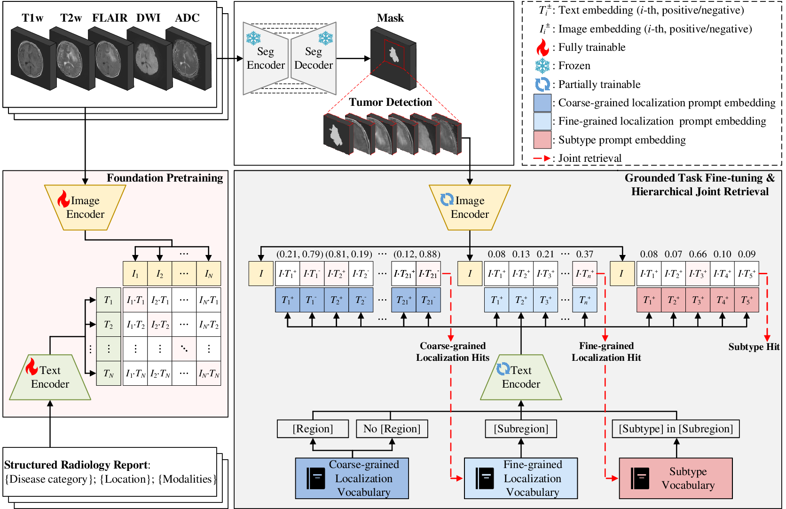
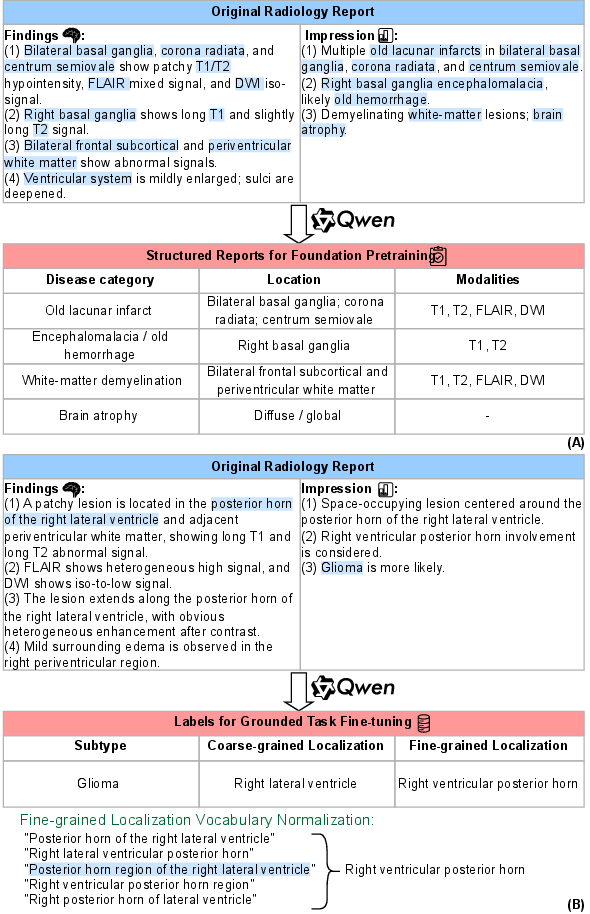
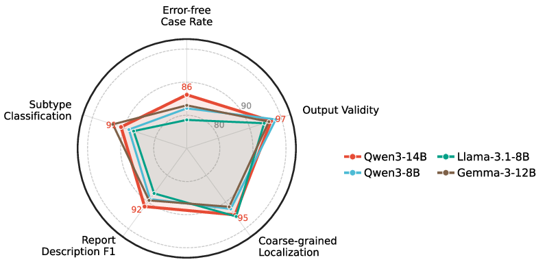
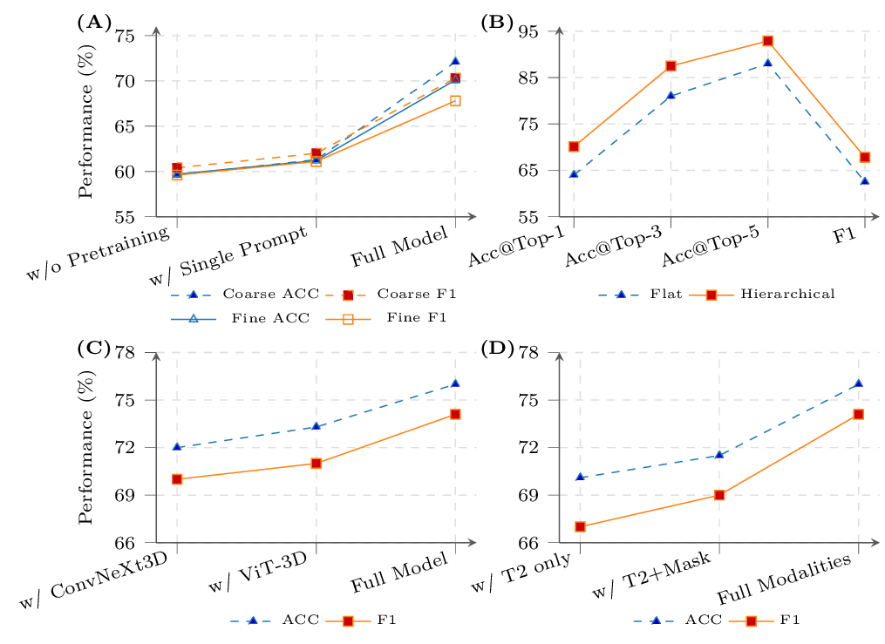
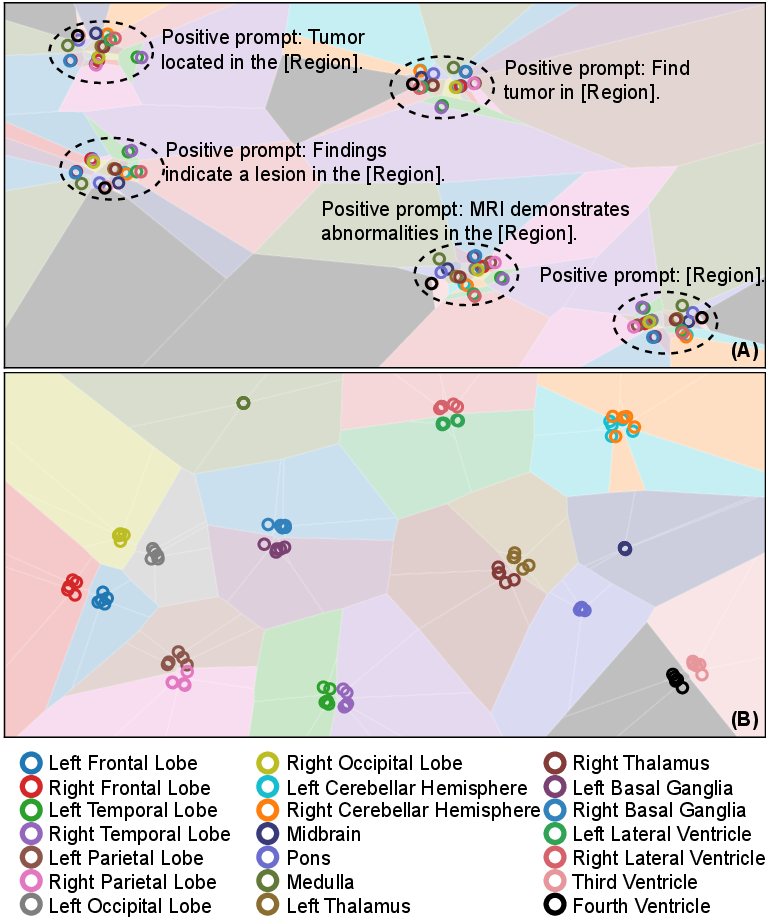
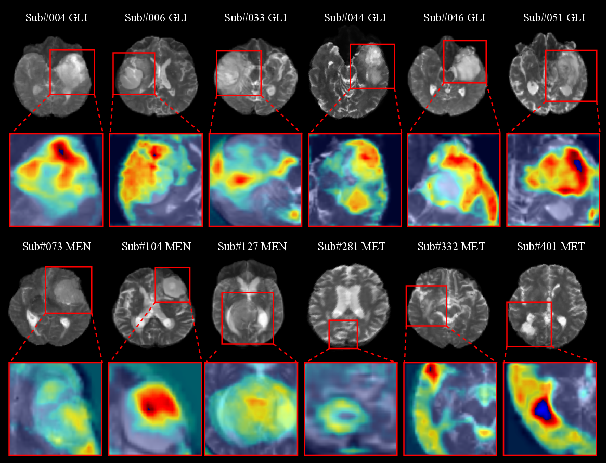

# LIGHT

**Learning Image-Text Grounding for Hierarchical Brain Tumor Localization and
Subtype Classification in Multimodal MRI**

LIGHT is a 3D vision-language framework for brain tumor MRI analysis. It
represents anatomical regions, fine-grained subregions, and tumor subtypes as
human-readable text prompts, then retrieves the prompts that best match a
tumor-centered MRI embedding.

LIGHT provides three high-level capabilities:

- Coarse-grained localization over 21 anatomical regions
- Fine-grained localization over 563 report-derived subregions
- Tumor subtype classification in the same image-text embedding space

The repository is under active preparation. The current release contains a
runnable NumPy reference implementation of the retrieval algorithm and losses,
the public coarse-region vocabulary overview, manuscript figures, data-access
notes, and placeholders for the full model release.

## More About LIGHT

LIGHT formulates brain tumor analysis as hierarchical image-text retrieval
rather than a collection of independent closed-set prediction heads.



The framework consists of the following stages:

| Stage | Description |
| --- | --- |
| Large-scale foundation pretraining | Aligns multimodal 3D MRI volumes with structured radiology reports using symmetric image-text contrastive learning. |
| Grounded task fine-tuning | Uses a frozen segmentation prior to generate tumor-centered inputs and adapts the embedding space with anatomical and subtype prompts. |
| Hierarchical joint retrieval | Retrieves coarse regions first, restricts fine-grained candidates to compatible subregions, and predicts tumor subtype from the same image embedding. |

At test time, LIGHT requires MRI inputs only. Report parsing is performed
offline, and text prompt embeddings can be pre-computed before inference.

### Reference Components

The public reference implementation currently includes:

| Component | Description |
| --- | --- |
| [`light.clip_loss`](src/light/losses.py) | Symmetric InfoNCE loss used for image-report foundation pretraining. |
| [`light.downstream_loss`](src/light/losses.py) | Weighted combination of coarse-region BCE, fine-region cross-entropy, and subtype cross-entropy losses. |
| [`light.PromptBank`](src/light/retrieval.py) | Container for pre-computed prompt embeddings and the fine-to-coarse anatomical hierarchy. |
| [`light.hierarchical_retrieve`](src/light/retrieval.py) | Multi-template scoring and coarse-to-fine retrieval with subtype prediction. |

For multi-template prompts, each template is encoded and scored separately.
Final class scores are obtained by averaging template-specific similarities,
not by averaging raw text embeddings.

## Installation

### Prerequisites

- Python 3.10 or later
- `pip`

### Get the Source

```bash
git clone https://github.com/qiuzhaoyu/LIGHT.git
cd LIGHT
```

### Install Dependencies

The current reference implementation has one runtime dependency:

```bash
python -m pip install -r requirements.txt
```

The environment specification for the complete training pipeline will be added
with the full implementation release.

## Getting Started

Run the deterministic retrieval demo:

```bash
python scripts/run_retrieval_demo.py
```

Expected output:

```text
Coarse localization: cerebellum
Fine localization: left cerebellar hemisphere
Subtype classification: hemangioma
```

The demo uses synthetic embeddings. It exercises the released hierarchical
retrieval flow without requiring clinical data or a trained checkpoint.

## Results And Visualizations

### Dataset And Validation Summary



The study includes in-house, external clinical, and public validation cohorts.
Private clinical MRI data are not redistributed, while public data links and
release notes are maintained in [`data/data.md`](data/data.md).

### LLM-Assisted Label Validation



Report structuring and downstream label extraction are performed offline.
LLM-derived downstream label candidates are manually reviewed before training,
and the extraction pipeline is evaluated separately from the final retrieval
model.

### Ablation Summary



The ablation study evaluates foundation pretraining, prompt-template design,
hierarchical retrieval, image-encoder backbones, and modality or mask inputs.

### Embedding And Attention Visualizations



The text-side visualization illustrates how projected prompt embeddings become
more anatomically organized after grounded task fine-tuning.



Grad-CAM visualizations show the image regions that contribute to the retrieved
localization and subtype hypotheses.

## Repository Layout

```text
LIGHT/
+-- assets/
|   +-- figures/          # README figures and manuscript figure sources
+-- checkpoints/          # Checkpoint release notes
+-- data/                 # Data access and sample metadata notes
+-- docs/                 # Additional project documentation
+-- examples/             # Example release notes
+-- scripts/              # Runnable demos and utility scripts
+-- src/
|   +-- light/
|       +-- losses.py     # Pretraining and downstream losses
|       +-- retrieval.py  # Hierarchical retrieval reference implementation
+-- requirements.txt      # Dependencies for the released reference code
```

## Data And Checkpoints

Private clinical MRI data cannot be redistributed. Public-dataset links,
sample metadata, and preprocessing notes will be documented in
[`data/data.md`](data/data.md).

The released coarse-region vocabulary overview is available in
[`data/location_vocabulary/`](data/location_vocabulary/):

- [`coarse_regions_21.csv`](data/location_vocabulary/coarse_regions_21.csv):
  the 21 coarse anatomical regions shown in the manuscript.

Checkpoint availability and download instructions will be documented in
[`checkpoints/README.md`](checkpoints/README.md).

## Release Status

- [x] Hierarchical retrieval reference implementation
- [x] Pretraining and downstream loss reference implementation
- [x] Synthetic retrieval demo
- [ ] Public preprocessing scripts
- [x] Coarse-region vocabulary overview
- [ ] Fine-grained prompt vocabulary files
- [ ] Encoder model implementation and trained weights
- [ ] Training and evaluation entry points
- [ ] Checkpoint download instructions
- [ ] Sample-data inference demo

See [`docs/release_plan.md`](docs/release_plan.md) for the detailed release
checklist.

## Citation

Citation information will be added after publication.

## License

LIGHT is released under the terms in [`LICENSE`](LICENSE).

## Contact

For questions and release updates, please open an issue in this repository.
